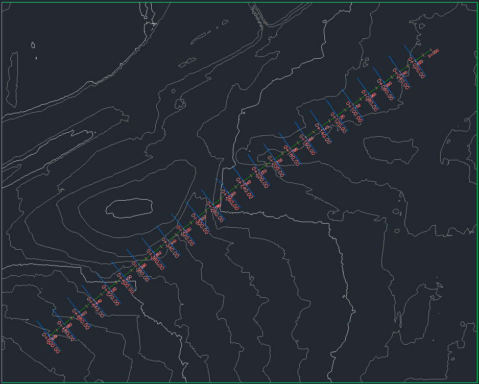
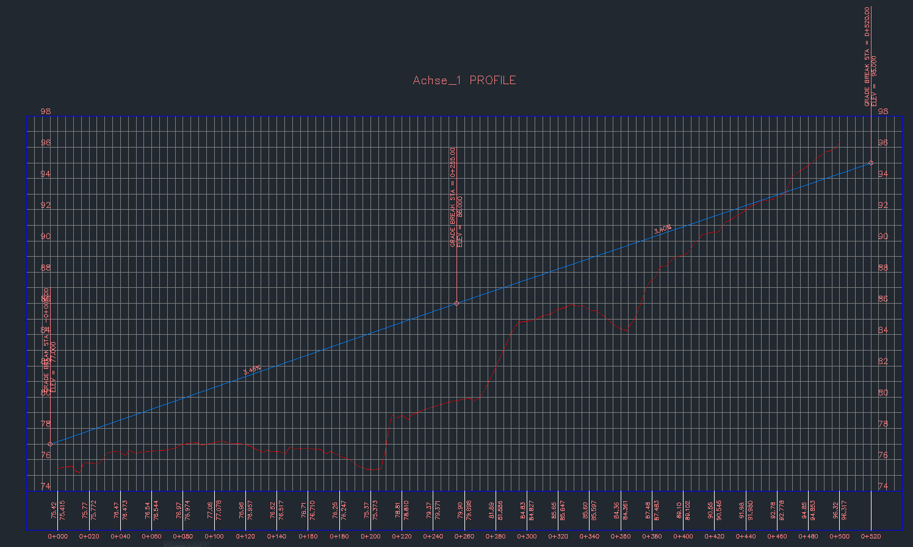
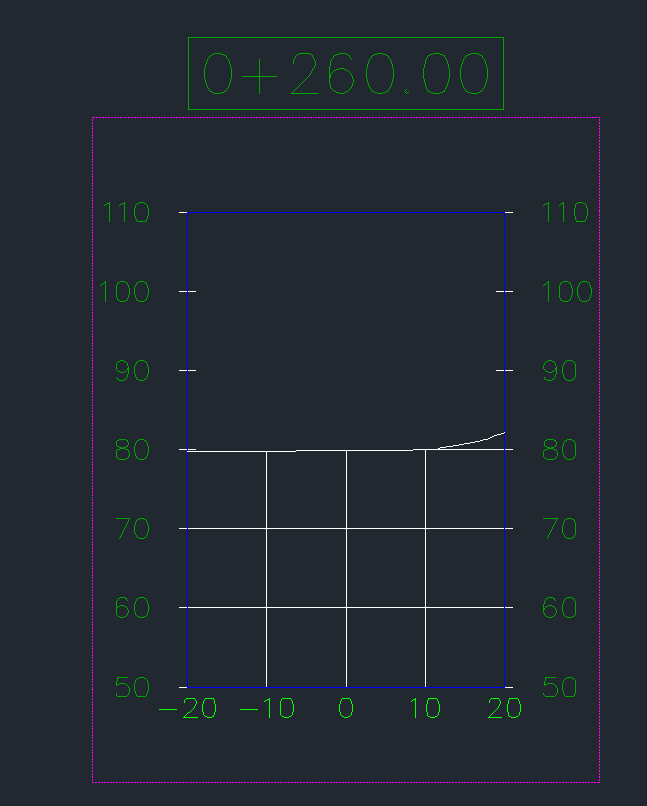
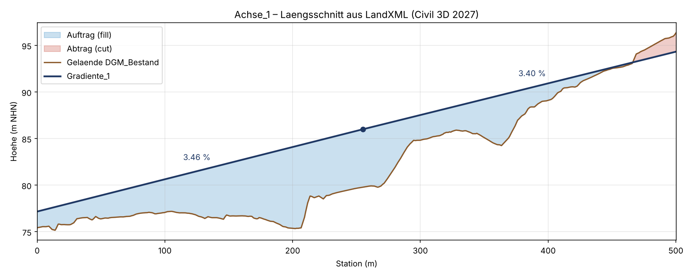
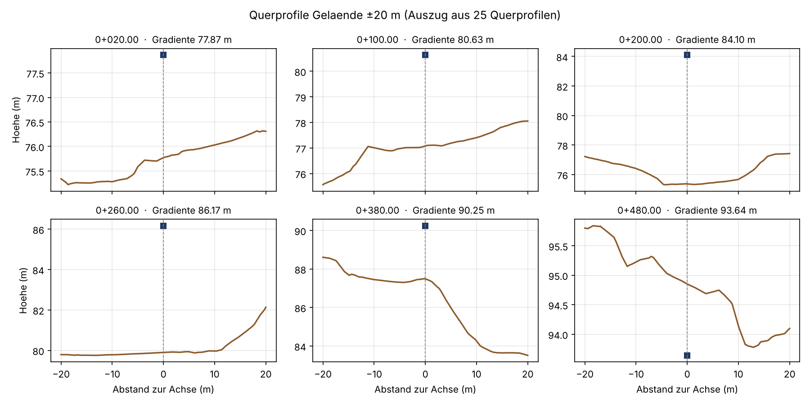
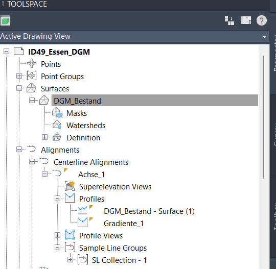

# Civil 3D – Terrain Model, Alignment, Profile and Cross Sections

[English](#civil-3d--terrain-model-alignment-profile-and-cross-sections) | [Deutsch](#deutsch)

A complete basic road design workflow in **Autodesk Civil 3D 2027** on real terrain from the **DGM1 NRW (Essen)**: **50,000 DGM points** → **TIN terrain model** with contours → **alignment** (2 tangents + arc R = 200 m, 500 m) → **existing ground profile** and **design profile (Gradiente)** → **25 sample lines and cross sections every 20 m** → **LandXML export**. The LandXML file is then checked with **Python**: station table, cut/fill heights on the centreline, cross slopes and charts – the typical tasks of a civil engineering or surveying office.



---

## Key results

| | |
|---|---|
| Terrain | DGM1 NRW (Essen), 2 m point grid, area E 366000–366500 / N 5702150–5702550, ETRS89 / UTM 32N (EPSG:25832) |
| Terrain model | TIN surface **DGM_Bestand**: **50,000 points**, **99,102 triangles**, 19.8 ha, **70.75–98.90 m NHN**, contours 2 m / 10 m |
| Alignment | **Achse_1**, length **500.25 m**: 2 tangents + 1 arc **R = 200 m**, station 0+000 at E 366450 / N 5702500 |
| Existing ground on the axis | **75.42 m** (0+000) → **96.36 m** (0+500) |
| Design profile | **Gradiente_1**, PVI at 0+255 (**86.00 m**), grades **3.46 %** and **3.40 %** |
| Cross sections | **25 sample lines** every 20 m, swath width ±20 m, 25 section views |
| Cut / fill on the centreline | fill on **466 m** (max. **8.90 m**), cut on **34 m** (max. **2.04 m**) at the end of the axis |
| Export | LandXML 1.2 with surface, alignment, profiles and cross sections |

**Interpretation:** the design profile with about 3.4 % grade lies above the existing ground on most of the alignment. The largest fill height (about 8.9 m) is in the valley at station 0+200, where the ground drops to 75.4 m. Only at the end of the axis (from about 0+466) the ground is higher than the design profile (cut up to 2.0 m). For a real project the design profile would be lowered in the middle part or a bridge/culvert would be checked for the valley, and the corridor with assembly, slopes and volumes would be the next step.

| | |
|---|---|
|  |  |





---

## Workflow in Civil 3D

| Step | Content |
|---|---|
| **1 Drawing settings** | Template *_Autodesk Civil 3D (Metric) NCS*, coordinate system **ETRS89.UTM-32N**, units metres |
| **2 Terrain model** | *Create Surface* (TIN) → *Definition → Point Files → Add* (format ENZ space delimited, 50,000 DGM1 points) |
| **3 Alignment** | Polyline → *Create Alignment from Objects*, curve R = 200 m between the tangents |
| **4 Profile** | *Create Surface Profile* from DGM_Bestand → *Profile View* → *Profile Creation Tools* (design profile with 3 PVIs) |
| **5 Cross sections** | *Sample Lines* by range of stations (every 20 m, ±20 m) → *Create Multiple Section Views* |
| **6 Export** | *Output → Export to LandXML* |
| **7 Check in Python** | `scripts/landxml_auswertung.py` reads the LandXML file and creates the station table, key figures and charts |



## Limitations

- The alignment and the design profile are fictitious; the terrain is real
- No corridor, assembly or slopes – so no earthwork volumes; cut/fill heights are given on the centreline only
- Civil 3D was used in the 30-day trial version (non-commercial)

---

## Repository structure

```
Civil3D-Terrain-Alignment-Profile/
├── data/
│   └── ID49_Essen.xml                 # LandXML export from Civil 3D
├── scripts/
│   └── landxml_auswertung.py          # check and charts in Python
├── images/
│   ├── 01_Lageplan_Civil3D.png
│   ├── 02_Laengsschnitt_Civil3D.png
│   ├── 03_Querprofil_0260_Civil3D.png
│   ├── 04_Prospector_Civil3D.png
│   ├── 05_Laengsschnitt_LandXML.png
│   └── 06_Querprofile_LandXML.png
├── results/
│   ├── civil3d_achse_gradiente.xlsx   # key figures and station table
│   ├── stationstabelle.csv
│   └── kennzahlen.csv
├── requirements.txt
├── LICENSE
└── README.md
```

Run the check with `pip install -r requirements.txt` and `python scripts/landxml_auswertung.py`. The LandXML file can also be opened in Civil 3D, QGIS or other CAD/GIS software.

## Tools

Autodesk Civil 3D 2027 · LandXML · Python · pandas · NumPy · Matplotlib · Excel

## Data sources

Digital terrain model DGM1: Geobasis NRW, Datenlizenz Deutschland – Zero – Version 2.0 (dl-de/zero-2-0), tile dgm1_32_366_5702_1_nw_2025 (section 500 × 400 m, 2 m point grid). Alignment and design profile are fictitious.

## License

Code: MIT License – see [LICENSE](LICENSE)

---
---

# Deutsch

[English](#civil-3d--terrain-model-alignment-profile-and-cross-sections) | [Deutsch](#deutsch)

Ein vollständiger Grundablauf der Straßenplanung in **Autodesk Civil 3D 2027** auf echtem Gelände aus dem **DGM1 NRW (Essen)**: **50.000 DGM-Punkte** → **DGM als TIN** mit Höhenlinien → **Achse** (2 Geraden + Kreisbogen R = 200 m, 500 m) → **Geländelängsschnitt** und **Gradiente** → **25 Querprofile alle 20 m** → **Export als LandXML**. Die LandXML-Datei wird anschließend mit **Python** geprüft: Stationstabelle, Auftrags- und Abtragshöhen in der Achse, Quergefälle und Grafiken – typische Aufgaben in einem Ingenieur- oder Vermessungsbüro.


---

## Zentrale Ergebnisse

| | |
|---|---|
| Gelände | DGM1 NRW (Essen), 2-m-Punktraster, Gebiet E 366000–366500 / N 5702150–5702550, ETRS89 / UTM 32N (EPSG:25832) |
| Geländemodell | TIN **DGM_Bestand**: **50.000 Punkte**, **99.102 Dreiecke**, 19,8 ha, **70,75–98,90 m NHN**, Höhenlinien 2 m / 10 m |
| Achse | **Achse_1**, Länge **500,25 m**: 2 Geraden + 1 Kreisbogen **R = 200 m**, Station 0+000 bei E 366450 / N 5702500 |
| Gelände in der Achse | **75,42 m** (0+000) → **96,36 m** (0+500) |
| Gradiente | **Gradiente_1**, Tangentenschnittpunkt bei 0+255 (**86,00 m**), Längsneigung **3,46 %** und **3,40 %** |
| Querprofile | **25 Querprofillinien** alle 20 m, Breite ±20 m, 25 Querprofilpläne |
| Auftrag / Abtrag in der Achse | Auftrag auf **466 m** (max. **8,90 m**), Abtrag auf **34 m** (max. **2,04 m**) am Achsende |
| Export | LandXML 1.2 mit DGM, Achse, Längsschnitten und Querprofilen |

**Interpretation:** Die Gradiente mit rund 3,4 % Längsneigung liegt auf dem größten Teil der Achse über dem Gelände. Die größte Auftragshöhe (rund 8,9 m) liegt in der Senke bei Station 0+200, wo das Gelände auf 75,4 m abfällt. Nur am Achsende (ab etwa 0+466) liegt das Gelände höher als die Gradiente (Abtrag bis 2,0 m). In einem echten Projekt würde man die Gradiente im mittleren Teil absenken oder für die Senke ein Bauwerk (Brücke/Durchlass) prüfen; der nächste Schritt wäre der Korridor mit Regelquerschnitt, Böschungen und Massen.

---

## Arbeitsablauf in Civil 3D

| Schritt | Inhalt |
|---|---|
| **1 Zeichnungseinstellungen** | Vorlage *_Autodesk Civil 3D (Metric) NCS*, Koordinatensystem **ETRS89.UTM-32N**, Einheit Meter |
| **2 Geländemodell** | *Create Surface* (TIN) → *Definition → Point Files → Add* (Format ENZ, 50.000 DGM1-Punkte) |
| **3 Achse** | Polylinie → *Create Alignment from Objects*, Kreisbogen R = 200 m zwischen den Geraden |
| **4 Längsschnitt** | *Create Surface Profile* aus DGM_Bestand → *Profile View* → *Profile Creation Tools* (Gradiente mit 3 Tangentenschnittpunkten) |
| **5 Querprofile** | *Sample Lines* nach Stationsbereich (alle 20 m, ±20 m) → *Create Multiple Section Views* |
| **6 Export** | *Output → Export to LandXML* |
| **7 Prüfung in Python** | `scripts/landxml_auswertung.py` liest die LandXML-Datei und erzeugt Stationstabelle, Kennzahlen und Grafiken |

## Einschränkungen

- Achse und Gradiente sind fiktiv, das Gelände ist echt
- Kein Korridor, kein Regelquerschnitt und keine Böschungen – daher keine Massen; Auftrags- und Abtragshöhen nur in der Achse
- Civil 3D wurde in der 30-Tage-Testversion (nicht kommerziell) verwendet

## Werkzeuge

Autodesk Civil 3D 2027 · LandXML · Python · pandas · NumPy · Matplotlib · Excel

## Datenquellen

Digitales Geländemodell DGM1: Geobasis NRW, Datenlizenz Deutschland – Zero – Version 2.0 (dl-de/zero-2-0), Kachel dgm1_32_366_5702_1_nw_2025 (Ausschnitt 500 × 400 m, 2-m-Punktraster). Achse und Gradiente sind fiktiv.

## Lizenz

Code: MIT License – siehe [LICENSE](LICENSE)
